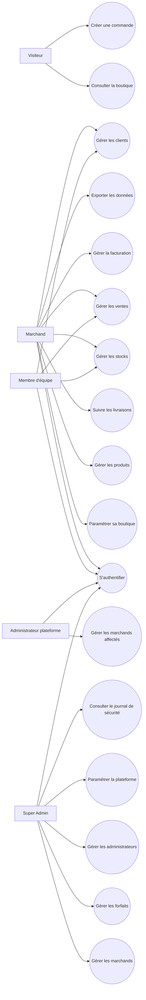
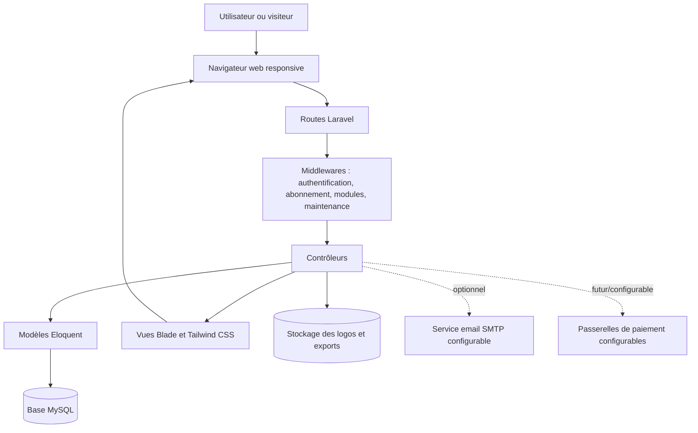
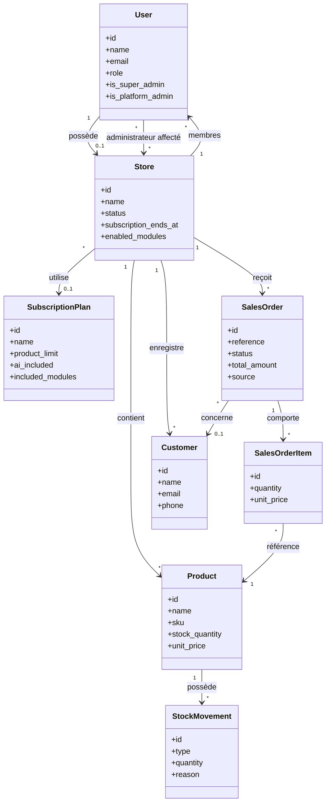
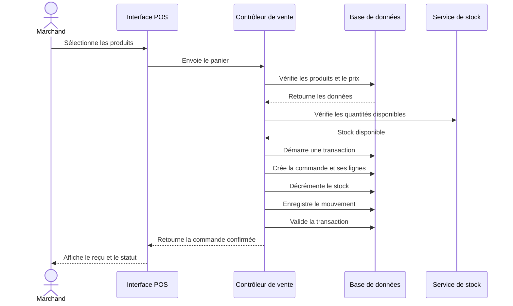
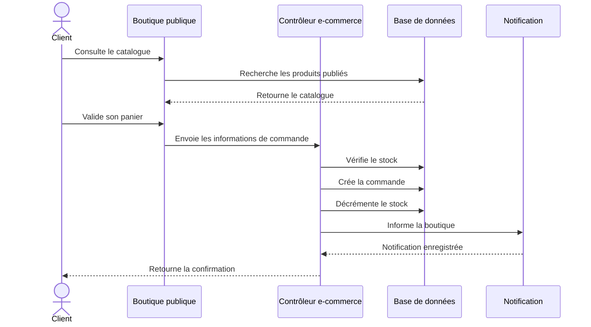
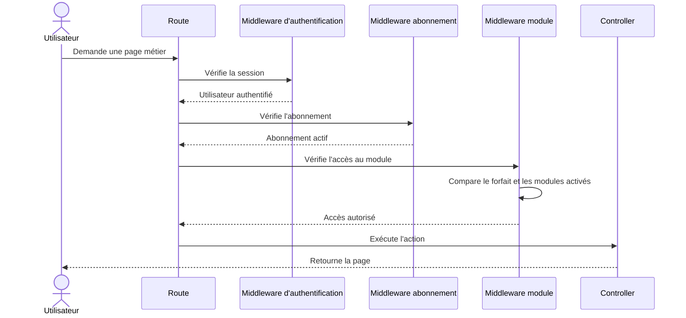
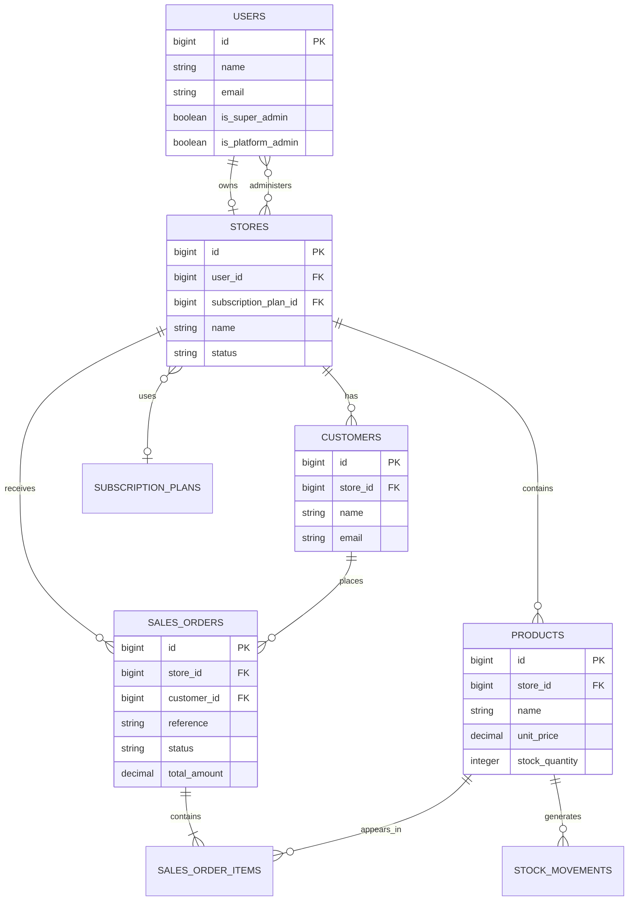
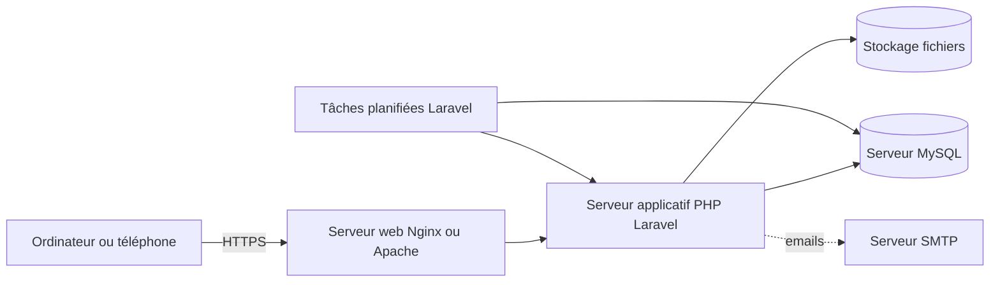
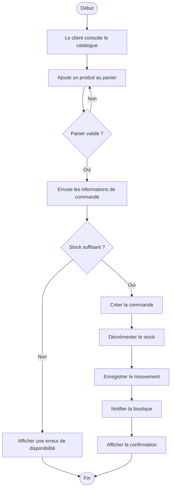

# GROUPE CEFIAT ABIDJAN

**Site officiel :** [http://cefiat.ci/](http://cefiat.ci/)

## Licence professionnelle en génie logiciel

### MÉMOIRE DE FIN DE FORMATION

## CONCEPTION ET DÉVELOPPEMENT D’UNE PLATEFORME WEB INTÉGRÉE DE GESTION COMMERCIALE ET DE COMMERCE ÉLECTRONIQUE : CAS DE HUBMARCHAND

**Présenté par :**  
**DROH KESSE YVES ROLAND**

**Structure d’accueil :** TECSOM-CI  
**Maître de stage :** Monsieur BAMIDELE  
**Encadreur académique :** Monsieur Guy Evra  

**Période de stage :** du 16 février 2025 au 28 décembre 2025  
**Année d’obtention :** 2022-2023

> *Remarque de mise en forme : cette page devra être adaptée au modèle officiel du Groupe CEFIAT Abidjan. Les noms des membres du jury, la ville et la date de soutenance pourront être ajoutés lorsque l’établissement les aura communiqués.*

---

# DÉDICACE

Je dédie ce travail à ma famille pour son soutien constant, ses encouragements et les sacrifices consentis tout au long de mon parcours académique et professionnel.

Je le dédie également à toutes les personnes qui m’ont accompagné, conseillé et encouragé durant la réalisation de ce projet.

---

# REMERCIEMENTS

La réalisation de ce mémoire a été possible grâce au soutien de plusieurs personnes auxquelles j’adresse mes sincères remerciements.

Je remercie en premier lieu la direction du Groupe CEFIAT Abidjan pour la formation reçue et pour les connaissances acquises durant mon parcours en Licence professionnelle de génie logiciel.

J’exprime ma profonde gratitude à Monsieur Guy Evra, mon encadreur académique, pour ses conseils, ses orientations et le suivi apporté à ce travail.

Je remercie également Monsieur Bamidele, mon maître de stage chez TECSOM-CI, pour son accueil, sa disponibilité et les conseils professionnels qui ont contribué à l’aboutissement de ce projet.

Je remercie enfin ma famille, mes amis et toutes les personnes qui m’ont apporté leur soutien moral, technique ou matériel pendant la période de formation et de stage.

---

# RÉSUMÉ

La gestion commerciale des petites entreprises repose encore souvent sur des outils dispersés tels que les cahiers, les feuilles de calcul et des applications indépendantes. Cette organisation rend le suivi des produits, des stocks, des ventes, des clients, des livraisons et des commandes en ligne difficile. Elle augmente également le risque d’erreurs et limite la disponibilité des informations nécessaires à la prise de décision.

Le présent mémoire porte sur la conception et le développement de **HubMarchand**, une plateforme web intégrée de gestion commerciale et de commerce électronique. La solution permet à un marchand de centraliser la gestion de sa boutique, de ses produits, de ses stocks, de ses ventes, de ses clients, de ses livraisons et de sa facturation. Elle propose également une boutique électronique, un système de forfaits, un contrôle d’accès aux modules, des notifications, des exports de données et un espace d’administration de la plateforme.

La solution a été développée avec le framework Laravel, le langage PHP, une base de données MySQL, les vues Blade, Tailwind CSS et JavaScript. Une attention particulière a été accordée à la sécurité, notamment à l’authentification, à la limitation des tentatives de connexion, à la vérification des adresses email, à la récupération des mots de passe, à la séparation des rôles et au mode maintenance.

Les tests réalisés montrent que les fonctionnalités principales sont opérationnelles. La suite de tests comporte 71 tests réussis pour 267 assertions au moment de la rédaction. Les intégrations de paiement réel sont préparées par configuration, mais restent désactivées tant que les identifiants des fournisseurs ne sont pas renseignés.

**Mots-clés :** gestion commerciale, commerce électronique, Laravel, plateforme web, SaaS, stock, sécurité, PME.

---

# ABSTRACT

Small businesses often use several disconnected tools to manage products, inventory, sales, customers, deliveries and online orders. This situation increases data entry errors and makes commercial monitoring more difficult.

This dissertation presents the design and development of **HubMarchand**, an integrated web platform for business management and e-commerce. The application centralizes product, inventory, sales, customer, delivery, invoicing and online store management. It also includes subscription plans, module access control, notifications, data exports and a platform administration area.

The platform was developed with Laravel, PHP, MySQL, Blade, Tailwind CSS and JavaScript. Security features include authentication, login throttling, email verification, password reset, role separation, secure sessions and maintenance mode.

The implemented features were validated through automated tests. The test suite currently contains 71 successful tests and 267 assertions. Real payment integrations are prepared through environment configuration but remain disabled until provider credentials are supplied.

**Keywords:** business management, e-commerce, Laravel, web platform, SaaS, inventory, security, SMEs.

---

# LISTE DES SIGLES ET ABRÉVIATIONS

| Sigle | Signification |
|---|---|
| API | Application Programming Interface |
| B2B | Business to Business |
| CSS | Cascading Style Sheets |
| HTTP | HyperText Transfer Protocol |
| MVC | Model View Controller |
| OTP | One-Time Password |
| PME | Petite et Moyenne Entreprise |
| POS | Point Of Sale |
| SaaS | Software as a Service |
| SQL | Structured Query Language |
| UML | Unified Modeling Language |
| URL | Uniform Resource Locator |
| UX | User Experience |

---

# INTRODUCTION GÉNÉRALE

La transformation numérique modifie progressivement les habitudes de travail des entreprises. Les activités commerciales qui étaient auparavant réalisées sur papier ou à l’aide de fichiers isolés sont désormais prises en charge par des applications capables de centraliser les données et d’automatiser certaines opérations.

Dans le contexte ivoirien, les commerçants et les petites entreprises doivent gérer plusieurs aspects de leur activité : l’achat et la vente des produits, le suivi des stocks, l’enregistrement des clients, la préparation des commandes, la livraison et parfois la vente en ligne. Lorsque ces opérations ne sont pas réunies dans un même système, le responsable doit multiplier les outils et les saisies. Cette organisation peut provoquer des incohérences entre le stock réel et le stock affiché, des erreurs de calcul et des difficultés à produire des rapports.

Le commerce électronique ajoute une nouvelle exigence. Une entreprise qui publie ses produits sur Internet doit pouvoir synchroniser son catalogue, suivre les commandes reçues et conserver une information fiable sur la disponibilité des produits. La boutique en ligne ne doit donc pas fonctionner comme un système complètement indépendant de la gestion interne.

C’est dans ce contexte que s’inscrit le projet HubMarchand réalisé au sein de TECSOM-CI, dans le cadre d’une formation en Licence professionnelle de génie logiciel au Groupe CEFIAT Abidjan. L’objectif est de proposer une plateforme web intégrée permettant à un marchand de gérer ses activités commerciales à partir d’un espace unique.

Le travail présenté dans ce mémoire répond à la problématique suivante :

> **Comment concevoir et développer une plateforme web intégrée permettant aux petites entreprises de centraliser la gestion de leurs stocks, ventes, clients, livraisons et activités de commerce électronique, tout en assurant un contrôle sécurisé des accès ?**

Pour répondre à cette question, le mémoire est organisé en trois parties. La première présente le contexte, l’étude de l’existant et l’analyse des besoins. La deuxième décrit la conception et la réalisation de la plateforme. La troisième est consacrée à la sécurité, aux tests, aux résultats, aux limites et aux perspectives.

---

# PREMIÈRE PARTIE : ÉTUDE ET CONCEPTION

## CHAPITRE 1 : PRÉSENTATION DU CADRE DU PROJET

### 1.1. Présentation de la structure d’accueil

Le projet a été réalisé au sein de **TECSOM-CI**, structure d’accueil de la période de stage. Le site institutionnel de l’entreprise présente TECSOM-CI comme une équipe d’experts au service de ses clients. La structure constitue le cadre professionnel dans lequel le besoin de conception et de développement de la solution a été étudié.

Dans la version finale du mémoire, cette présentation pourra être complétée avec les informations institutionnelles validées par TECSOM-CI :

- la date de création ;
- les domaines d’activités ;
- l’organisation interne ;
- les principaux services proposés ;
- l’organigramme ;
- les coordonnées officielles.

Il est important de ne conserver dans la version soutenue que les informations confirmées par l’entreprise.

### 1.2. Cadre académique

La formation suivie est une Licence professionnelle en génie logiciel au **Groupe CEFIAT Abidjan**. Le site officiel de l’établissement est accessible à l’adresse [http://cefiat.ci/](http://cefiat.ci/). Cette formation vise à développer des compétences dans l’analyse, la conception, le développement, le déploiement et la maintenance des applications informatiques.

Le stage a constitué une occasion d’appliquer les connaissances acquises dans un contexte professionnel. Il a également permis de mieux comprendre la relation entre les besoins des utilisateurs, les contraintes techniques et les exigences de qualité d’un logiciel.

### 1.3. Déroulement du stage

Le stage s’est déroulé du **16 février 2025 au 28 décembre 2025**. Les principales activités réalisées ont été les suivantes :

1. compréhension du besoin de gestion commerciale ;
2. identification des utilisateurs et de leurs responsabilités ;
3. analyse des modules nécessaires ;
4. conception de la base de données ;
5. développement progressif de la plateforme ;
6. intégration des règles d’accès et d’abonnement ;
7. mise en place de la boutique électronique ;
8. ajout des exports et des notifications ;
9. validation par des tests ;
10. amélioration de la sécurité et de l’expérience utilisateur.

### 1.4. Contexte du projet

Une activité commerciale produit un volume important d’informations. Les produits possèdent des prix, des catégories et des quantités. Les ventes donnent lieu à des commandes et à des mouvements de stock. Les clients peuvent être associés à des commandes, des crédits ou des factures. Les commandes en ligne nécessitent un suivi supplémentaire concernant le paiement, la préparation et la livraison.

Sans outil centralisé, les informations sont susceptibles d’être dupliquées ou perdues. Une modification du prix ou de la quantité disponible peut ne pas être répercutée partout. Le responsable ne dispose pas toujours d’une vision synthétique de son activité.

HubMarchand répond à ce besoin par une plateforme modulaire. Le marchand dispose d’un espace de gestion tandis que la plateforme possède un espace d’administration permettant de gérer les boutiques, les forfaits, les modules et les paramètres globaux.

### 1.5. Problématique

Les difficultés observées peuvent être résumées ainsi :

- absence de centralisation des informations ;
- suivi manuel ou partiel des stocks ;
- difficulté à distinguer les ventes physiques des ventes en ligne ;
- faible automatisation du traitement des commandes ;
- manque de tableaux de bord ;
- absence de contrôle précis des droits utilisateurs ;
- difficulté à faire évoluer les fonctionnalités selon les besoins du marchand.

La problématique consiste donc à concevoir une solution accessible par navigateur, capable de réunir les principales opérations commerciales et de proposer un contrôle sécurisé des données.

### 1.6. Objectifs

#### Objectif général

Concevoir et développer une plateforme web intégrée de gestion commerciale et de commerce électronique destinée aux commerçants et aux petites entreprises.

#### Objectifs spécifiques

- gérer les comptes utilisateurs et les boutiques ;
- administrer les forfaits et leurs limites ;
- gérer les produits, variantes, catégories et fournisseurs ;
- suivre les mouvements et les niveaux de stock ;
- enregistrer les ventes et les commandes ;
- gérer les clients et les crédits ;
- suivre les livraisons ;
- produire des documents de facturation ;
- publier un catalogue électronique ;
- contrôler l’accès aux modules ;
- envoyer et consulter des notifications ;
- exporter les données ;
- sécuriser les parcours sensibles ;
- fournir un espace d’administration de la plateforme.

### 1.7. Hypothèse

L’hypothèse de travail est la suivante :

> **La centralisation des opérations commerciales dans une plateforme web intégrée améliore la fiabilité des données, réduit les tâches répétitives et facilite la prise de décision des petites entreprises.**

### 1.8. Méthodologie

La méthode adoptée est itérative. Elle consiste à analyser un besoin, concevoir la solution correspondante, développer le module, le tester puis l’améliorer.

Les étapes sont :

- recueil et clarification des besoins ;
- modélisation des acteurs et des données ;
- conception technique ;
- développement par modules ;
- vérification par tests ;
- correction des anomalies ;
- validation de l’ensemble.

---

## CHAPITRE 2 : ANALYSE DE L’EXISTANT ET EXPRESSION DES BESOINS

### 2.1. Étude de l’existant

Dans une organisation traditionnelle, les opérations commerciales peuvent être réparties entre un cahier pour les ventes, un fichier pour les stocks, des messages pour les commandes en ligne et des documents séparés pour les factures. Cette organisation présente plusieurs limites :

- les données sont difficiles à consolider ;
- l’historique est peu exploitable ;
- plusieurs personnes peuvent modifier des informations sans traçabilité ;
- le stock disponible n’est pas toujours connu immédiatement ;
- les rapports nécessitent un traitement manuel ;
- la boutique en ligne peut afficher des informations dépassées.

Les solutions généralistes disponibles sur le marché peuvent répondre à une partie de ces besoins, mais elles sont parfois coûteuses, complexes à configurer ou peu adaptées aux contraintes d’une petite entreprise. HubMarchand cherche à proposer une solution modulaire, progressive et adaptée à un usage commercial local.

### 2.2. Acteurs du système

Les principaux acteurs sont :

#### Visiteur

Il consulte éventuellement une boutique publique et peut parcourir le catalogue proposé.

#### Marchand

Il gère sa boutique, ses produits, ses stocks, ses commandes, ses clients et ses paramètres.

#### Membre d’équipe

Il travaille dans une boutique selon un rôle attribué : administrateur, responsable ou vendeur.

#### Administrateur plateforme

Il intervient sur un périmètre de marchands qui lui est attribué. Il ne possède pas les droits du Super Admin.

#### Super Admin

Il administre la plateforme, les marchands, les forfaits, les paramètres système, les administrateurs délégués et le journal de sécurité.

### 2.3. Besoins fonctionnels

#### Authentification et comptes

Le système doit permettre :

- la connexion ;
- la déconnexion ;
- la limitation des tentatives de connexion ;
- la récupération du mot de passe ;
- la vérification de l’adresse email ;
- la gestion des sessions ;
- la redirection selon le rôle.

#### Gestion de la boutique

Le marchand doit pouvoir :

- modifier le nom de sa boutique ;
- renseigner ses coordonnées ;
- ajouter un logo ;
- configurer les moyens de paiement déclarés ;
- activer ou désactiver des modules ;
- gérer les membres de son équipe.

#### Gestion des produits

Le système doit permettre :

- la création de produits ;
- la modification et la suppression ;
- la gestion des prix ;
- la gestion des catégories ;
- la gestion des références et codes-barres ;
- la gestion des variantes ;
- la publication dans la boutique.

#### Gestion des stocks

Le marchand doit pouvoir :

- connaître les quantités disponibles ;
- enregistrer les entrées ;
- enregistrer les sorties ;
- consulter les mouvements ;
- identifier les stocks faibles ;
- associer les stocks aux ventes.

#### Vente et point de vente

Le module de vente doit permettre :

- la création d’une commande ;
- l’ajout de produits ;
- le calcul du total ;
- l’association à un client ;
- la décrémentation transactionnelle du stock ;
- le suivi du statut de la commande.

#### Clients et crédits

Le système doit permettre :

- l’enregistrement des clients ;
- la consultation de leur historique ;
- la gestion de crédits ;
- l’enregistrement des paiements et relances.

#### Livraisons

Le module doit permettre :

- la définition de zones ;
- l’association d’un livreur ;
- la mise à jour du statut ;
- le suivi des commandes à livrer ;
- l’enregistrement des rapprochements.

#### Facturation B2B

Le système doit permettre :

- la création de documents B2B ;
- l’affichage des montants ;
- le suivi du statut ;
- la conversion de certains documents ;
- l’association à un client.

#### Commerce électronique

La boutique publique doit permettre :

- l’affichage du catalogue ;
- la recherche et le filtrage ;
- l’affichage des catégories ;
- l’ajout au panier ;
- la validation d’une commande ;
- la mise à jour du stock après commande.

#### Administration de la plateforme

Le Super Admin doit pouvoir :

- créer et gérer des marchands ;
- attribuer des forfaits ;
- définir les modules inclus ;
- suspendre ou réactiver une boutique ;
- consulter les journaux ;
- gérer l’identité de la plateforme ;
- créer des administrateurs délégués ;
- affecter des marchands à ces administrateurs.

### 2.4. Besoins non fonctionnels

La solution doit être :

- **sécurisée**, grâce à l’authentification, la validation et la séparation des droits ;
- **accessible**, par un navigateur sur ordinateur ou mobile ;
- **responsive**, grâce à des interfaces adaptées aux petits écrans ;
- **maintenable**, avec une organisation MVC et des responsabilités séparées ;
- **évolutive**, grâce à une architecture modulaire ;
- **fiable**, avec des transactions pour les opérations sensibles ;
- **performante**, en évitant les requêtes inutiles et les traitements excessifs ;
- **utilisable**, avec des messages d’erreur et de confirmation explicites.

### 2.5. Contraintes

Les contraintes du projet sont :

- disponibilité d’un navigateur et d’une connexion ;
- configuration correcte de PHP, MySQL et du serveur web ;
- dépendance aux services externes pour l’envoi d’emails ;
- nécessité de renseigner des identifiants pour les paiements réels ;
- protection des données et des mots de passe ;
- nécessité de sauvegarder régulièrement la base.

---

## CHAPITRE 3 : CONCEPTION DE LA SOLUTION

### 3.1. Architecture générale

HubMarchand adopte une architecture web de type client-serveur. Le navigateur constitue le client. Il envoie des requêtes HTTP au serveur Laravel. Le serveur traite les requêtes, applique les règles de sécurité, échange avec la base de données et retourne une réponse HTML, JSON ou un fichier exporté.

L’architecture applicative suit le modèle MVC :

- les **modèles** représentent les données et leurs relations ;
- les **contrôleurs** reçoivent les requêtes et coordonnent le traitement ;
- les **vues** affichent les résultats à l’utilisateur ;
- les **middlewares** contrôlent les accès transversaux ;
- les **migrations** décrivent l’évolution du schéma de la base ;
- les **notifications** gèrent les messages liés aux événements.

### 3.2. Organisation fonctionnelle

La plateforme est organisée autour des espaces suivants :

1. authentification ;
2. accueil marchand ;
3. stocks ;
4. point de vente ;
5. analytique ;
6. e-commerce ;
7. clients ;
8. livraisons ;
9. facturation ;
10. Copilot ;
11. paramètres ;
12. Super Admin ;
13. notifications ;
14. exports.

### 3.3. Règles d’abonnement

Chaque boutique peut être associée à un forfait. Le forfait détermine notamment :

- le prix mensuel et annuel ;
- la limite de produits ;
- l’inclusion ou non du module IA ;
- les moyens de paiement déclarés ;
- le caractère renouvelable ;
- les modules disponibles.

Une limite de produits nulle représente une capacité illimitée. Un module est accessible si deux conditions sont respectées :

1. il est inclus dans le forfait ;
2. il est activé dans les paramètres de la boutique.

Cette double vérification permet de distinguer les droits commerciaux du forfait et les préférences propres à la boutique.

### 3.4. Modèle de données

Les principales tables sont :

- `users` : utilisateurs, rôles, statut d’administration et vérification email ;
- `stores` : boutiques, identité, abonnement et configuration ;
- `subscription_plans` : forfaits et modules inclus ;
- `products` : produits et informations commerciales ;
- `product_variants` : variantes ;
- `stock_movements` : entrées et sorties ;
- `suppliers` : fournisseurs ;
- `purchase_orders` : bons de commande ;
- `customers` : clients ;
- `sales_orders` : commandes ;
- `sales_order_items` : lignes de commande ;
- `delivery_*` : éléments liés aux livraisons ;
- `b2b_documents` : documents de facturation ;
- `notifications` : notifications persistées ;
- `platform_audit_logs` : journal des actions d’administration ;
- `system_settings` : configuration globale ;
- `platform_admin_store` : périmètre des administrateurs délégués.

### 3.5. Sécurité conceptuelle

La sécurité repose sur plusieurs niveaux :

- authentification par session ;
- régénération de session après connexion ;
- invalidation de session après déconnexion ;
- hachage des mots de passe ;
- limitation des tentatives ;
- vérification email ;
- validation des données entrantes ;
- contrôle par middleware ;
- filtrage des boutiques assignées ;
- protection CSRF des formulaires ;
- en-têtes HTTP de sécurité ;
- mode maintenance ;
- séparation des responsabilités entre Super Admin et administrateur délégué.

### 3.6. Parcours de connexion

Le parcours de connexion est le suivant :

1. l’utilisateur saisit son email et son mot de passe ;
2. la requête est limitée par adresse email et adresse IP ;
3. les identifiants sont vérifiés ;
4. la session est régénérée ;
5. l’adresse email est vérifiée pour les comptes marchands ;
6. l’abonnement de la boutique est contrôlé ;
7. l’utilisateur est redirigé vers son espace.

### 3.7. Diagramme de cas d’utilisation

Le diagramme suivant présente les principaux acteurs et leurs interactions avec la plateforme.



### 3.8. Diagramme d’architecture

HubMarchand est une application web centralisée. Le navigateur communique avec Laravel, qui applique les règles métier et échange avec MySQL. Les services d’email, de stockage et de paiement sont optionnels et configurables.



### 3.9. Diagramme de classes simplifié

Le diagramme présente les principales relations du modèle métier.



### 3.10. Diagramme de séquence d’une vente



### 3.11. Diagramme de séquence d’une commande en ligne



### 3.12. Diagramme de séquence d’autorisation d’un module



### 3.13. Modèle logique de données



### 3.14. Gestion des erreurs

Les erreurs de validation sont retournées à l’interface. Les accès non autorisés renvoient une réponse HTTP appropriée. Les erreurs techniques doivent être journalisées sans afficher de données sensibles à l’utilisateur.

---

# DEUXIÈME PARTIE : RÉALISATION

## CHAPITRE 4 : TECHNOLOGIES ET ENVIRONNEMENT

### 4.1. PHP

PHP est le langage utilisé pour développer la logique serveur. Il permet de traiter les requêtes, de manipuler les données et de générer les réponses.

### 4.2. Laravel

Laravel est le framework principal du projet. Il fournit :

- le routage ;
- les contrôleurs ;
- l’ORM Eloquent ;
- les migrations ;
- les middlewares ;
- l’authentification ;
- la validation ;
- les notifications ;
- la gestion des fichiers ;
- les tests.

Le framework facilite la structuration du code et favorise la séparation des responsabilités.

### 4.3. MySQL

MySQL est utilisé pour stocker les données de production. Les relations entre les tables permettent de rattacher les produits, commandes, clients, utilisateurs et boutiques.

### 4.4. Blade

Blade est le moteur de templates utilisé pour produire les interfaces HTML. Il permet d’afficher les données, de réutiliser les composants et d’appliquer des conditions d’affichage.

### 4.5. Tailwind CSS

Tailwind CSS est utilisé pour construire l’interface responsive. Les classes utilitaires facilitent la création des cartes, formulaires, tableaux, menus et interfaces mobiles.

### 4.6. JavaScript

JavaScript intervient pour les interactions d’interface, notamment le menu mobile, certaines actions du panier et l’ajout dynamique de lignes.

### 4.7. Bibliothèques d’export

Le projet utilise :

- DomPDF pour les documents PDF ;
- Laravel Excel pour les fichiers Excel ;
- PhpWord pour les documents Word.

### 4.8. Outils de qualité

Les outils utilisés comprennent :

- Pest pour les tests ;
- Laravel Pint pour le formatage PHP ;
- les commandes Artisan pour les migrations, les tests et la compilation ;
- Git ou un système équivalent pour le suivi du code.

---

## CHAPITRE 5 : IMPLÉMENTATION DES MODULES

### 5.1. Authentification

L’authentification permet de distinguer les marchands, les membres d’équipe, les administrateurs plateforme et le Super Admin. Après une connexion réussie, la session est régénérée afin de réduire le risque de fixation de session.

La récupération du mot de passe utilise le mécanisme de réinitialisation de Laravel. Le lien envoyé est limité dans le temps et le mot de passe est remplacé uniquement après validation du token.

La vérification email est appliquée aux comptes marchands. Un compte non vérifié est orienté vers la page de vérification et ne peut pas accéder aux modules métier.

### 5.2. Accueil

L’accueil présente les modules sous forme de cartes. Chaque carte indique le nom du module et son état d’accessibilité. Lorsqu’un module n’est pas inclus dans le forfait ou désactivé dans la boutique, un cadenas est affiché et l’accès est bloqué.

L’accueil peut également présenter des indicateurs tels que :

- le chiffre d’affaires ;
- le nombre de commandes ;
- le panier moyen ;
- le nombre de visiteurs ;
- les alertes de stock.

### 5.3. Gestion des produits

Le marchand peut créer un produit avec son nom, sa référence, sa catégorie, son prix, son prix d’achat, sa quantité initiale et éventuellement ses variantes.

Les contrôles de validation empêchent notamment les valeurs incohérentes pour les prix et les quantités. Les produits peuvent être publiés ou non dans la boutique électronique.

### 5.4. Gestion du stock

Les mouvements de stock permettent de conserver un historique des entrées et sorties. Une vente est traitée dans une transaction afin que la commande et la diminution du stock restent cohérentes.

Cette approche évite qu’une commande soit enregistrée alors que la quantité disponible n’a pas été correctement diminuée.

### 5.5. Point de vente

Le module POS permet de rechercher des produits, de constituer un panier de vente, d’associer une commande à un client et de finaliser la vente. Le montant total est calculé à partir des lignes de commande.

Les statuts permettent de suivre l’évolution de la commande. Les données peuvent être exportées selon les formats disponibles.

### 5.6. Clients et CRM

Le module clients conserve les informations utiles à la relation commerciale : nom, email, téléphone, adresse et segment. Il permet de consulter l’historique et les informations liées aux crédits.

### 5.7. Livraisons

Le module de livraison complète le traitement des commandes. Il permet d’associer un livreur, une zone et un statut de livraison. Les rapprochements peuvent être enregistrés afin de suivre les opérations effectuées.

### 5.8. Facturation B2B

La facturation B2B permet de créer des documents associés à des clients professionnels. Les documents possèdent un numéro, un type, un statut, un montant et une date.

### 5.9. Boutique électronique

La boutique publique utilise les produits publiés par la boutique. Le visiteur peut consulter le catalogue et constituer une commande. Le traitement de la commande vérifie la disponibilité des produits et met à jour le stock.

La boutique possède également des paramètres de présentation :

- sous-domaine ;
- domaine personnalisé ;
- phrase d’accroche ;
- annonce ;
- méthodes de paiement déclarées ;
- paiement à la livraison.

Les paiements réels ne sont pas activés automatiquement. La configuration des fournisseurs est prévue dans les variables d’environnement afin d’éviter l’exposition des secrets.

### 5.10. Forfaits et abonnements

Le Super Admin peut créer et modifier des forfaits. Pour chaque forfait, il peut définir :

- le prix mensuel ;
- le prix annuel ;
- la limite de produits ;
- l’accès à l’IA ;
- les moyens de paiement ;
- le caractère renouvelable ;
- les modules inclus.

Lorsqu’un abonnement arrive à échéance, la boutique peut être suspendue automatiquement par la commande planifiée prévue à cet effet.

### 5.11. Administration de la plateforme

Le Super Admin dispose d’un espace de gestion des marchands et des forfaits. Il peut consulter les boutiques, modifier leur statut, attribuer un forfait et consulter le journal.

Les administrateurs délégués peuvent être créés par le Super Admin et affectés à un ou plusieurs marchands. Leur périmètre est contrôlé côté serveur et non uniquement dans l’interface.

### 5.12. Paramètres système

Les paramètres système permettent de modifier :

- le nom de la plateforme ;
- le logo ;
- la couleur principale ;
- la couleur secondaire ;
- la couleur d’accent ;
- l’email support ;
- le téléphone support ;
- le mode maintenance.

Les couleurs sont validées au format hexadécimal. Le logo est contrôlé comme fichier image et stocké sur le disque public.

### 5.13. Notifications

Les notifications sont enregistrées dans la base de données. Elles peuvent informer l’utilisateur de l’expiration d’un abonnement ou d’une action importante. Le centre de notifications permet de consulter et de marquer les messages comme lus.

### 5.14. Exports

Les exports sont disponibles en :

- PDF ;
- Excel ;
- Word.

Les ressources prises en charge comprennent notamment les produits, les clients, les commandes, la facturation, les livraisons, les marchands et les forfaits.

Les fichiers sont générés à partir de données filtrées par boutique. Les données d’un marchand ne doivent pas être accessibles par un autre marchand.

---

# TROISIÈME PARTIE : SÉCURITÉ, TESTS ET ÉVALUATION

## CHAPITRE 6 : SÉCURITÉ ET QUALITÉ

### 6.1. Authentification et mots de passe

Les mots de passe ne sont pas stockés en clair. Ils sont hachés avant l’enregistrement. Le formulaire de connexion utilise une validation et un mécanisme de limitation pour éviter les tentatives répétées.

La récupération du mot de passe utilise des tokens temporaires. Le token est invalidé lorsque la réinitialisation est effectuée.

### 6.2. Autorisation

La simple connexion ne donne pas accès à toutes les fonctions. Les middlewares vérifient :

- le rôle ;
- l’existence d’un abonnement actif ;
- l’accès au module ;
- le périmètre de l’administrateur ;
- l’état de maintenance.

### 6.3. Isolation des boutiques

Chaque donnée métier est rattachée à une boutique. Les contrôleurs récupèrent la boutique courante à partir de l’utilisateur authentifié. Les actions d’administration déléguée vérifient que le marchand fait partie du périmètre attribué.

### 6.4. Validation des entrées

Les données reçues sont validées avant traitement. Les règles portent notamment sur :

- les emails ;
- les dates ;
- les montants ;
- les identifiants ;
- les fichiers ;
- les couleurs ;
- les modules autorisés.

### 6.5. Protection des formulaires

Les formulaires utilisent la protection CSRF de Laravel. Les fichiers téléversés sont validés et enregistrés avec un nom généré par le framework.

### 6.6. En-têtes de sécurité

Les réponses web ajoutent notamment :

- `X-Content-Type-Options: nosniff` ;
- `X-Frame-Options: SAMEORIGIN` ;
- `Referrer-Policy: strict-origin-when-cross-origin` ;
- `Permissions-Policy`.

En HTTPS, l’application peut également utiliser l’en-tête HSTS.

### 6.7. Mode maintenance

Le mode maintenance permet de bloquer les utilisateurs marchands tout en conservant l’accès du Super Admin. Une page dédiée informe l’utilisateur et affiche les coordonnées du support lorsqu’elles sont configurées.

### 6.8. Limites de sécurité

Avant la mise en production, les améliorations suivantes sont recommandées :

- activer une double authentification OTP ;
- configurer un SMTP fiable ;
- protéger les secrets dans un gestionnaire adapté ;
- activer HTTPS ;
- mettre en place des sauvegardes chiffrées ;
- contrôler les dépendances ;
- installer une surveillance des erreurs ;
- définir une politique de conservation des journaux.

---

## CHAPITRE 7 : TESTS ET VALIDATION

### 7.1. Stratégie de test

La validation repose sur des tests fonctionnels automatisés. Chaque test vérifie un comportement observable à partir d’une requête ou d’une action utilisateur.

Les tests sont organisés autour des domaines suivants :

- authentification ;
- administration ;
- abonnements ;
- modules ;
- paramètres ;
- e-commerce ;
- notifications ;
- exports ;
- sécurité ;
- maintenance.

### 7.2. Exemples de cas de test

| ID | Fonctionnalité | Résultat attendu |
|---|---|---|
| T01 | Connexion avec identifiants valides | L’utilisateur est redirigé vers son espace |
| T02 | Connexion avec mauvais mot de passe | Un message d’erreur est affiché |
| T03 | Sixième tentative rapprochée | La réponse est limitée par HTTP 429 |
| T04 | Boutique non vérifiée | L’utilisateur est envoyé vers la vérification email |
| T05 | Accès à un module non inclus | L’accès est refusé |
| T06 | Stock insuffisant lors d’une commande | La commande n’est pas validée |
| T07 | Expiration d’un abonnement | La boutique est suspendue |
| T08 | Accès d’un administrateur délégué | Seuls les marchands affectés sont visibles |
| T09 | Export d’une ressource | Un fichier PDF, Excel ou Word est généré |
| T10 | Mode maintenance | Le marchand reçoit une page HTTP 503 |
| T11 | Endpoint de santé | L’application et la base sont déclarées disponibles |

### 7.3. Résultats

Au moment de la rédaction, la suite automatisée comporte :

- **71 tests réussis** ;
- **267 assertions** ;
- compilation Blade réussie ;
- formatage Laravel Pint validé.

Ces résultats montrent que les comportements couverts par les tests sont conformes aux règles définies. Ils ne signifient pas que toutes les situations possibles sont testées. Des tests de navigateur, de charge et d’intégration avec les fournisseurs de paiement devront compléter la validation.

### 7.4. Tests manuels recommandés

Une validation manuelle doit également être réalisée sur :

- un ordinateur ;
- une tablette ;
- un téléphone ;
- plusieurs navigateurs ;
- un environnement avec une connexion lente ;
- un environnement sans service email ;
- des rôles différents ;
- plusieurs boutiques.

---

## CHAPITRE 8 : RÉSULTATS, LIMITES ET PERSPECTIVES

### 8.1. Résultats obtenus

Le projet a permis de réaliser une plateforme capable de centraliser plusieurs opérations commerciales. Le marchand possède un espace unifié et le Super Admin peut contrôler la plateforme.

Les principaux résultats sont :

- réduction de la dispersion des données ;
- amélioration du suivi des produits ;
- meilleure visibilité sur les commandes ;
- synchronisation entre catalogue et stock ;
- contrôle des modules par forfait ;
- amélioration de la sécurité des comptes ;
- disponibilité d’exports ;
- administration multi-boutiques.

### 8.2. Limites

Certaines fonctions nécessitent encore une configuration ou une intégration externe :

- les paiements Wave, Orange Money et carte ne sont pas activés par défaut ;
- l’envoi d’email dépend de la configuration SMTP ;
- la double authentification complète doit encore être intégrée ;
- les sauvegardes et le monitoring doivent être déployés sur l’infrastructure cible ;
- les tests de charge et de navigateur ne sont pas inclus dans la suite principale ;
- les couleurs globales doivent être progressivement appliquées à toutes les interfaces.

Ces limites ne remettent pas en cause l’architecture de la solution. Elles correspondent à des étapes de mise en production et d’intégration avec des services externes.

### 8.3. Perspectives

Les évolutions possibles sont :

1. intégration de Wave, Orange Money et d’un fournisseur de paiement par carte ;
2. ajout des webhooks de confirmation ;
3. ajout d’une double authentification OTP ;
4. développement d’une application mobile ;
5. notifications SMS et WhatsApp ;
6. rapports avancés et prévisions de ventes ;
7. synchronisation avec des services comptables ;
8. gestion de plusieurs entrepôts ;
9. gestion des achats et réapprovisionnements automatisés ;
10. déploiement avec sauvegardes et monitoring ;
11. amélioration de la personnalisation graphique ;
12. tests de performance et de sécurité automatisés.

---

# CONCLUSION GÉNÉRALE

Le présent mémoire avait pour objectif de concevoir et développer une plateforme web intégrée de gestion commerciale et de commerce électronique. Le projet a abouti à la réalisation de HubMarchand, une application Laravel permettant de centraliser la gestion des boutiques, des produits, des stocks, des ventes, des clients, des livraisons, de la facturation et de la vente en ligne.

La solution intègre également un système de forfaits, une gestion des modules, un espace Super Admin, des administrateurs délégués, des notifications, des exports et un paramétrage global. Les mécanismes de sécurité comprennent l’authentification, la récupération du mot de passe, la vérification email, le contrôle des permissions, la limitation des connexions, la protection CSRF et les en-têtes de sécurité.

La problématique posée était de savoir comment centraliser les activités commerciales des petites entreprises tout en assurant un contrôle sécurisé des accès. La solution développée apporte une réponse concrète à cette problématique en réunissant les principaux processus dans un seul système web.

Les tests automatisés ont permis de vérifier les comportements essentiels de l’application. Le résultat obtenu constitue une base fonctionnelle et évolutive pour une plateforme commerciale. Toutefois, une mise en production complète nécessitera la configuration des emails, des paiements, des sauvegardes, du monitoring et des services d’infrastructure.

Ce projet nous a permis de renforcer nos compétences en analyse, conception, développement Laravel, gestion des bases de données, sécurité applicative et tests logiciels. Il représente également une première étape vers la création d’outils numériques adaptés aux besoins des commerçants et des petites entreprises en Côte d’Ivoire.

---

# BIBLIOGRAPHIE INDICATIVE

1. Groupe CEFIAT Abidjan, *Site officiel*, [http://cefiat.ci/](http://cefiat.ci/), consulté le 21 septembre 2026.
2. Laravel Documentation, *Laravel 13.x Documentation*, documentation officielle.
3. Laravel Documentation, *Authentication, Authorization and Verification*, documentation officielle.
4. Laravel Documentation, *Database, Eloquent ORM and Migrations*, documentation officielle.
5. OWASP Foundation, *OWASP Top 10 Web Application Security Risks*.
6. Object Management Group, *Unified Modeling Language Specification*.
7. MySQL Documentation, *MySQL Reference Manual*.
8. Martin Fowler, *Patterns of Enterprise Application Architecture*, Addison-Wesley.
9. Robert C. Martin, *Clean Code: A Handbook of Agile Software Craftsmanship*, Prentice Hall.
10. Ian Sommerville, *Software Engineering*, Pearson.

Les dates de consultation et les liens exacts devront être ajoutés selon les exigences bibliographiques du Groupe CEFIAT Abidjan.

---

# ANNEXES

## Annexe 1 : Captures d’écran à intégrer

Les captures suivantes sont recommandées :

1. page de connexion ;
2. page de récupération du mot de passe ;
3. tableau de bord marchand ;
4. cartes des modules ;
5. gestion des produits ;
6. mouvements de stock ;
7. point de vente ;
8. gestion des clients ;
9. gestion des livraisons ;
10. facturation B2B ;
11. catalogue public ;
12. panier et commande ;
13. gestion des forfaits ;
14. paramétrage boutique ;
15. paramètres système ;
16. administrateurs délégués ;
17. centre de notifications ;
18. écran d’export ;
19. écran de maintenance ;
20. panel Super Admin.

## Annexe 2 : Commandes de validation

```bash
php artisan migrate --force --no-interaction
php artisan view:cache --no-interaction
vendor/bin/pint --format agent
php artisan test --compact
```

## Annexe 3 : Configuration indicative

```env
APP_NAME=HubMarchand
APP_ENV=production
APP_DEBUG=false
APP_URL=https://votre-domaine.example

DB_CONNECTION=mysql
DB_HOST=127.0.0.1
DB_PORT=3306
DB_DATABASE=hubmarchand
DB_USERNAME=utilisateur
DB_PASSWORD=mot_de_passe

MAIL_MAILER=smtp
MAIL_HOST=
MAIL_PORT=587
MAIL_USERNAME=
MAIL_PASSWORD=
MAIL_ENCRYPTION=tls
MAIL_FROM_ADDRESS=
MAIL_FROM_NAME=HubMarchand

PAYMENTS_ENABLED=false
PAYMENT_PROVIDER=manual
WAVE_ENABLED=false
ORANGE_MONEY_ENABLED=false
CARD_PAYMENTS_ENABLED=false
```

Les vraies valeurs doivent être placées uniquement dans l’environnement de déploiement et ne doivent jamais être publiées dans le mémoire ou dans le dépôt de code.

## Annexe 4 : Données de démonstration

Le seeder de démonstration crée notamment :

- un compte marchand de démonstration ;
- un compte Super Admin ;
- des forfaits ;
- une boutique ;
- des produits de démonstration.

Les mots de passe de démonstration ne doivent pas être conservés en production. Ils doivent être remplacés ou supprimés lors du déploiement.

## Annexe 5 : Éléments à compléter avant soutenance

- page de garde selon le modèle de l’établissement ;
- logo du Groupe CEFIAT Abidjan ;
- lien officiel du Groupe CEFIAT Abidjan : [http://cefiat.ci/](http://cefiat.ci/) ;
- logo TECSOM-CI ;
- organigramme validé ;
- diagramme de cas d’utilisation ;
- diagramme de classes ;
- diagrammes de séquence ;
- modèle physique de données ;
- captures d’écran ;
- dates de consultation bibliographique ;
- membres du jury ;
- pagination et table des matières automatique.

## Annexe 6 : Diagramme de déploiement

Le diagramme suivant représente une installation classique de la plateforme sur un serveur web.



## Annexe 7 : Diagramme d’activité d’une commande



## Annexe 8 : Consignes de production des diagrammes

Les blocs Mermaid peuvent être convertis en images avec un outil compatible Mermaid, puis insérés dans la version Word ou PDF du mémoire. Pour la version imprimée :

1. générer chaque diagramme en SVG ou PNG ;
2. ajouter un numéro et un titre sous chaque figure ;
3. citer la figure dans le chapitre correspondant ;
4. conserver une résolution suffisante pour l’impression ;
5. vérifier que les noms des tables et des acteurs correspondent à la version finale du logiciel.
